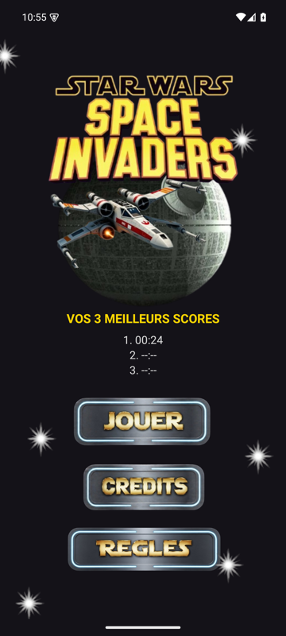
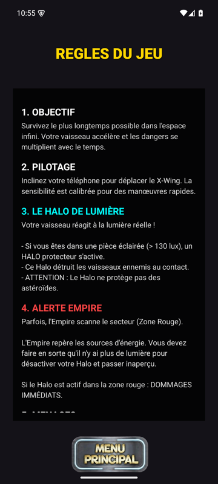
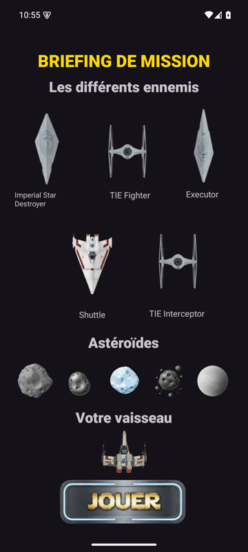
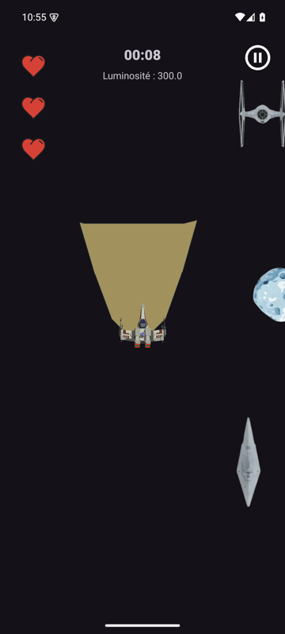
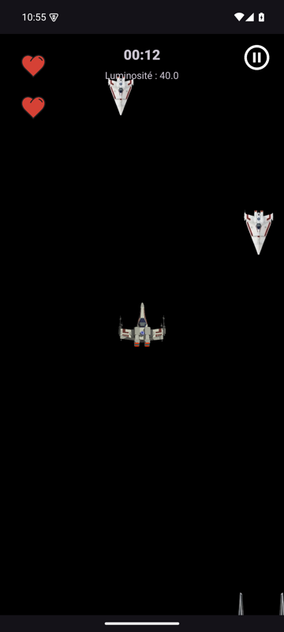

# Star Wars Space Invaders

Jeu Android en Kotlin. Le joueur pilote un X-Wing en inclinant le téléphone et doit survivre le plus longtemps possible. La lumière de la pièce, captée par le capteur de lumière du téléphone, change le déroulement de la partie.

## Menu principal

Le menu affiche les 3 meilleurs temps, enregistrés sur le téléphone. Il donne accès au jeu, aux crédits et aux règles.



## Règles et briefing

L'écran des règles explique le principe du jeu. Avant chaque partie, le briefing présente les ennemis, les astéroïdes et le vaisseau du joueur.

| Règles | Briefing |
|---|---|
|  |  |

## En jeu

- Le X-Wing se déplace en inclinant le téléphone.
- Le chronomètre affiche le temps de survie, et le jeu accélère avec le temps.
- Le joueur a 3 vies (les coeurs en haut à gauche) et un bouton pause.
- **Pièce éclairée (plus de 130 lux)** : un halo de lumière apparaît devant le vaisseau et détruit les vaisseaux ennemis. Il ne détruit pas les astéroïdes.
- **Pièce sombre** : l'écran devient noir, le halo s'éteint et on ne voit presque plus rien.
- **Zone rouge de l'Empire** : toutes les 15 secondes, un rectangle ou un cercle rouge traverse l'écran. Si on le touche avec le halo allumé, on perd une vie. Il faut donc éteindre la lumière pour passer.
- Quand on n'a plus de vies, une fenêtre affiche le temps de la partie et le top 3. On peut alors rejouer ou revenir au menu.

| Lumière forte | Lumière faible |
|---|---|
|  |  |

## Lancer le projet

Prérequis : Android Studio, ou le SDK Android 36 avec un JDK 17.

1. Ouvrir le dossier dans Android Studio.
2. Lancer l'application sur un téléphone ou un émulateur.

En ligne de commande :

```
./gradlew assembleDebug
adb install -r app/build/outputs/apk/debug/app-debug.apk
```

Le téléphone doit avoir un capteur de lumière. Sinon, le jeu affiche un message et revient à l'accueil. Sur un émulateur, on règle la lumière et l'inclinaison dans Extended controls > Virtual sensors.

## Structure

| Fichier | Rôle |
|---|---|
| `MainActivity.kt` | Menu principal et top 3 |
| `RulesActivity.kt` | Règles du jeu |
| `BriefingController.kt` | Briefing avant la partie |
| `InfiniteGameActivity.kt` | Boucle de jeu, apparition des ennemis, zones rouges, pause et fin de partie |
| `Vaisseau.kt` | Vaisseau du joueur (déplacement, vies, invulnérabilité) |
| `Ennemi.kt`, `Ovni.kt` | Vaisseaux ennemis et astéroïdes |
| `CapteurManager.kt` | Accéléromètre et capteur de lumière |
| `ScoreManager.kt` | Sauvegarde des 3 meilleurs temps (JSON) |
| `MusicManager.kt` | Musique et sons |
| `CreditActivity.kt` | Crédits |
